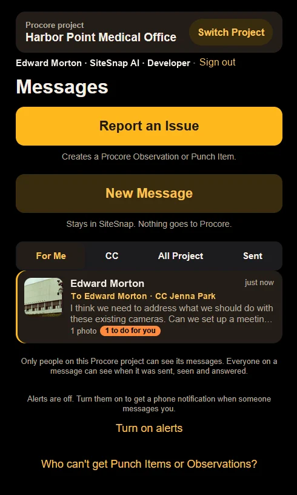
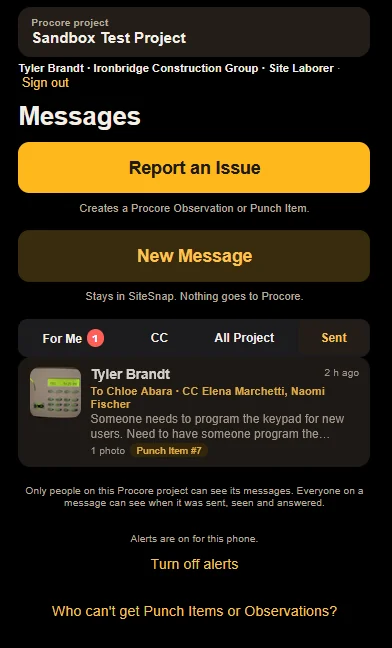
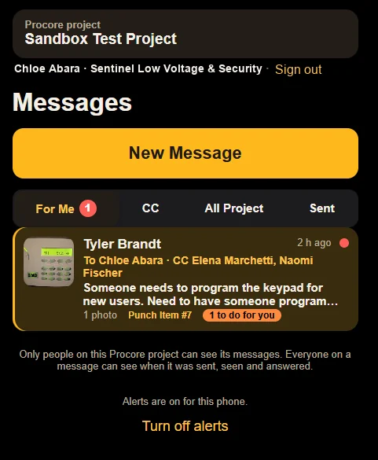
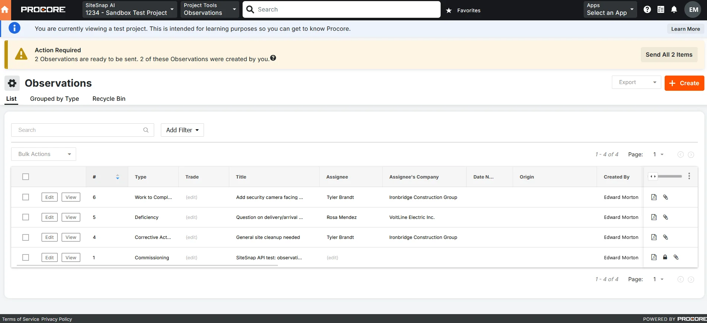
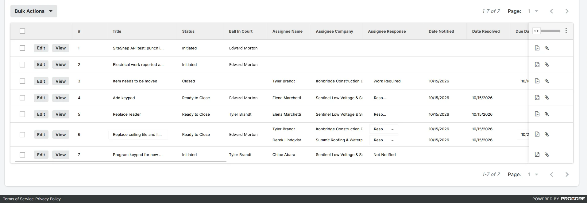

# SiteSnap AI

**Report a jobsite issue by voice and photo, straight into Procore, walk Procore inspections one question at a time, follow it up with the crew, and keep the project's photos in Procore.**

> **In development.** SiteSnap AI has been tested only in Procore's developer sandbox, with fictional people, companies, and projects. No real crew uses it yet. It needs a Procore sign-in, so it isn't open to visitors. SiteSnap AI is an independent project. It isn't affiliated with, sponsored by, or endorsed by Procore Technologies, Inc.; Procore is a trademark of its owner.

SiteSnap AI is a phone-first web app for construction crews that works with Procore. Everyone signs in with their own Procore account and picks a Procore project, and that project's directory is the team. The project home has five tiles: Report an issue, Message (with the count of messages waiting for you), Inspection, Daily log, and Project photos.

1. **Report an Issue: voice + photo → a real Procore record.** A foreman takes a photo and says what's wrong. Claude drafts an **Observation** or a **Punch Item** using the project's own lists, and one tap creates it in Procore with the photo and the voice recording attached.
2. **Project messaging, like Microsoft Teams for one jobsite.** A Procore project is the team and messages are threads. You tag who a message is for, CC people to keep them in the loop, and attach photos and a transcribed voice note. Claude pulls out the to-dos and who they're for.
3. **Project photos, kept in Procore's own Photos tool.** Browse the project's photos by day, area, trade, or album, and snap new ones with an optional voice note. They file into that day's album, even when there's no signal at the time.
4. **Inspections, one question at a time (new, being checked in the sandbox).** A foreman walks a Procore inspection on the phone with big Pass, Fail, and N/A buttons, by tap or by voice, with photos and spoken notes. A Fail becomes a Procore Observation in one tap, linked to the failed item.
5. **Daily log by voice (being checked in the sandbox).** A foreman says one end-of-day update ("six guys on site, drywall delayed waiting on materials, forklift delivery at 10"). Claude sorts it into Procore Daily Log entries (Manpower, Delays, Deliveries, Notes), the foreman checks the cards, and Send writes each one into Procore's Daily Log for that day, with photos.

**Portfolio case study, with a looping demo and a quick tour:** https://ky-gray-portfolio.vercel.app/#sitesnap
**Built on:** [PicTalk](https://github.com/mrkygray-art/pictalk) (the `master` branch). This `sitesnap` branch is the SiteSnap fork, and every push to it deploys to the SiteSnap app on Vercel.

<p>
  
  
  
</p>

## Report an Issue

1. **Take a photo and talk.** Deepgram writes the words down, and the foreman can fix them before going on.
2. **Fill It In.** Claude (strict JSON) decides between Observation and Punch Item. It fills in the assignee, type, location, trade, and due date **only when they match the project's real lists in Procore**. Anything it isn't sure about stays blank for the foreman to pick. On the spec's sample sentences it picked the right record type 5 out of 5 times.
3. **Check and send.** The confirmation card says plainly where the record goes (Procore's Observations tool or its Punch List). If Procore won't let the chosen person receive that record, the card says so and offers a project manager instead. **Send to Procore** creates the record with the reporter's own Procore sign-in, so Procore shows the real author, and "Reported by … via SiteSnap AI" goes in the description. The photo and voice recording are attached.
4. **The thread follows the record.** The report becomes a SiteSnap thread with to-dos for the assignee. Done in SiteSnap moves the record to **Ready for Review**, and the project manager closes it with one tap in SiteSnap or in Procore. Opening the thread re-reads the record's status from Procore.

CC is SiteSnap-only: a CC'd person sees the thread in their CC tab but is never added to the Procore record or its distribution, so Procore doesn't send extra email.

<p>
  
</p>

## Project messaging

- **Feed:** For Me (tagged and open, with unread dots and to-do badges), CC, All Project, and Sent.
- **New message:** To / CC → photos (up to 10) → Tap to Talk (the words come back before sending and can be edited) → note → Send. A message can't be sent without tagging someone.
- **AI to-dos:** Claude reads each message and assigns tasks only to tagged people, with a due phrase. People mark them done.
- **Quick replies:** Done, On it, Delayed (with a reason and a new date), and Need info, plus more behind **More**. Done also finishes that person's to-dos.
- **Tracking:** the thread shows who has seen and answered it ("Tyler · Seen 9:13 AM · On it 9:14 AM").
- **Phone alerts:** web push through Firebase Cloud Messaging. Everyone on a thread except the sender is notified, and tapping the alert opens the thread.
- **No signal:** messages wait on the phone and send later.
- **Privacy:** only members of a Procore project can read its messages, and the database rules enforce it.
- **Who is this for?:** search the project directory by name, title (job title or Procore project role), or company, with one typo forgiven. You can tag everyone at a company or everyone with a title.

<p>
  
</p>

## Inspections

The foreman never opens Procore's Inspections tool. Procore's API still calls inspections "checklists".

- **The list:** Assigned to me (the foreman is one of the inspection's inspectors), My company's work (their company is the responsible contractor), and other open inspections on the project. Each row shows the name and number ("Site Safety Inspection #2", since several can come from one template), location, due date, and progress ("12 of 87"). A long template disclaimer stays behind a Details link.
- **Sections:** every section with its answered count and Pass / Fail / N/A counts. Continue picks up at the first unanswered item, and Set N/A (with a confirm, or by saying "section not applicable") answers a whole section that doesn't apply.
- **One question at a time:** the item number ("2.3", which tells repeated questions apart), big Pass, Fail, and N/A buttons for gloves, Speak, and Photo. Saying "pass", "fail", or "N/A" picks the answer; anything else becomes a note on the item. Templates with their own answer choices, and text, number, or date questions, get their own inputs. Photos attach to the item and also go to Procore Photos.
- **A Fail becomes an Observation:** add a photo and say what's wrong, and one tap creates a Procore Observation through the same code as Report an Issue, with `inspection_item_failed` and the item's id, so Procore links it to the item and marks the item Deficient. The responsible contractor prefills when the inspection has one; otherwise "Choose who" opens the project directory. Skip, keep going records the Fail without an Observation and flags it on the summary.
- **Never lost:** every answer is saved on the phone first (IndexedDB) and sent in order, with backoff, so a dead zone shows "Not synced yet" and nothing is lost. Photos and Observations are sent once only, even when a retry follows a lost answer.
- **Several inspectors:** before saving, the server re-reads the item. If someone else answered it since the phone last looked, the foreman sees "Already answered by …" and keeps theirs or uses their own; nothing is overwritten quietly.
- **Finish:** the counts, each failed item with its Observation, and Submit, which closes the inspection in Procore when the person's role allows it ("Saved. Your project manager will review it." otherwise).

## Daily log by voice

The foreman never opens Procore's Daily Log. Nothing is written until they tap Send.

- **Talk, then check:** talk as many times as needed (the words add up and can be typed or fixed), add photos, and tap Organize My Log. Claude returns four sections as structured JSON, and the server keeps only companies, delay types, and locations that exist on the project. Anything unsure (AM or PM not said, a company that isn't on the project, a trade with no company) shows a **Check this** tag with one-tap answers. Nothing is invented: a blank box means "not said". If the model can't organize it, the whole update is kept as one Note.
- **Defaults:** the foreman's own company fills in when they don't name one ("six guys on site"), the date is the project's own date (Today, Yesterday, or another past day), and photos go with Notes unless given to an entry.
- **Send:** entries go to Procore one at a time with the person's own Procore sign-in, each with its own ✓ or Retry, so one failure never blocks the rest. Procore's rate limit gets "Procore is busy, trying again in a moment" and an automatic retry. SiteSnap asks before adding manpower for a company already logged that day, and never sets an entry's approval status.
- **Never lost:** the draft (words, cards, photos) stays on the phone until every entry is in, and the server remembers each entry's id, so a retry never creates a duplicate.
- **Past logs:** a New log | Past logs switch under the title. Past logs reads Procore's Daily Log live and lists only the days that have entries, newest first, 30 days at a time (Show older logs), in a list that scrolls on its own, with Go to a day above it for any date. Each day shows its totals and how many entries are yours; tapping the Past logs tab inside a day goes back to the list. A day lists everyone's entries with who made them and their approval status. Only your own entries have Edit and Delete, and the server checks Procore's author before changing anything. Once a day is marked Completed, Procore locks it; SiteSnap says so and points to the superintendent instead of trying to get around it. Edits never touch the approval status.
- **Permissions:** a person whose Procore role can't use the Daily Log sees a plain message naming their Procore permission template, instead of a broken screen. A sandbox check page tries each section as the signed-in person.

## Project photos

Procore's Photos tool is the system of record: SiteSnap keeps no photo gallery of its own.

- **Browse:** By day (grouped by the day each photo was taken, from the camera's time Procore keeps, else the day it reached Procore, in the project's time zone), By area (Procore locations) and By trade (Procore trades), which appear only once a photo carries one, and Albums (Procore albums with counts). The full view shows who took the photo, when, its album, area, trade, and description.
- **Built for a long list on a phone:** photos load 48 at a time as you scroll, and thumbnails download only as they come into view. The tabs and the Snap button stay pinned at the top, and each day's header pins under them. A day shows 3 rows (9 photos) with **See all N photos**, and **Go to a day** opens any date.
- **Each person's own sign-in:** Procore's photo links need a Procore sign-in, so photos load through a SiteSnap server endpoint using the viewer's own Procore sign-in. People see only what Procore already shows them, and the phone caches the photos.
- **Snap:** the camera opens straight away. Add an optional voice note (written down by speech-to-text) or typed words, and the photo goes into that day's `Field photos YYYY-MM-DD` album (created if missing, always public), or another album picked with one tap. Photos are shrunk to 2048 px before upload.
- **No signal:** photos are saved on the phone first (an IndexedDB queue) and uploaded oldest first when signal returns, with backoff. Each capture has its own id, so a retry never creates a duplicate photo in Procore.
- **Photos from reports and messages:** photos sent through Report an issue or a message are also filed in the day's album automatically (a per-phone setting, on by default), and filing never holds up the report or message. Photos from a report show "Linked to Punch Item #2" or the Observation they belong to.

Before building, the Photos API was checked in Procore's sandbox: album creation, permissions per person, description limits, paging, thumbnail access, and rate limits. One finding: subcontractor accounts on Procore's default "Subcontractor - External" permission template have Photos at Read Only, so a company must raise it to Standard before subs can add photos.

## What Procore's API taught us

- **Permissions are per person.** Each person can create only what their own permission template allows, and Procore answers 403 otherwise. SiteSnap reads the templates' levels while a company admin is signed in, saves them on the server, and warns before sending who can't receive Observations or Punch Items.
- **Observations created through the API are private by default.** SiteSnap sends `personal: false` so the team can see them.
- **Procore doesn't email anyone when the API creates a record.**
- **Rate limit:** about 25 calls per 10 seconds per user, so bulk work is paced, and a 429 waits and tries once more.
- **Directory data is often thin.** In the original sandbox only 1 of 9 people had a job title, so no feature assumes titles, companies, or roles are filled in.
- **Inspections are "checklists" in the API.** A sandbox check showed answers save (`item_response`), an answer can't be cleared again (422), and the read doesn't say which sections are N/A. Setting a section N/A answers every item in it N/A, and turning it off clears them all, so SiteSnap reads N/A from the items and asks before undoing it. Notes go to the inspection's comments with the item's id.
- **Webhooks exist** for Observations, Punch Items, and Change Events, but they need a sign-in that isn't a person's (a stored token or a service account).

Full notes: [`docs/sitesnap-procore-findings.md`](docs/sitesnap-procore-findings.md) and [`docs/PROCORE_API_NOTES.md`](docs/PROCORE_API_NOTES.md).

## Sandbox test pages

Hidden pages make realistic test data and check the API. They refuse to run outside Procore's developer sandbox, and none of them is linked from the app.

| Page | What it does |
| --- | --- |
| `/api/procore/seed-directory` | Test people: adds test companies and people with job titles, the Project Manager project role, and permission templates. Runs again safely and offers older test data for cleanup (made inactive, since Procore's API can't delete people). |
| `/api/procore/demo-staging` | Demo staging (needs `DEMO_MODE=true` and a Procore admin): creates three demo projects at early, middle, and closeout stages, adds 12 people, imports 15 scenarios as Observations and Punch Items with photos in small batches, and resets them. It only touches records tagged `[SS-DEMO]`. See [`docs/DEMO_STAGING.md`](docs/DEMO_STAGING.md). |
| `/api/procore/test-records` | Record test: proves the write path by creating an Observation and a Punch Item with a photo and an audio file. |
| `/api/procore/test-inspections` | Inspections check: reads the project's inspections, sections, and items; Run Write Check also answers the last item, sets the last section N/A and back, and adds a test note. See [`docs/inspections-api-notes.md`](docs/inspections-api-notes.md). |
| `/api/procore/test-permissions` | Permissions check (read only): what each permission template allows for Observations, the Punch List, Tasks, and the Directory, and who each tool accepts as an assignee. |

## How it's built

```text
Phone (React + Vite PWA, works offline)
   │  Procore sign-in (OAuth) ─────────────► Vercel functions  api/procore/*
   │                                          • tokens in an AES-256-GCM sealed httpOnly cookie
   │                                          • each person writes to Procore with their own token
   │                                          • Procore REST API: projects, directory, Observations, Punch Items, Photos
   │  Firebase custom token (uid procore_{id})
   ▼
Firebase project sitesnap-procore
   • Firestore: projects → conversations → messages (rules: project members only)
   • Storage: photos and voice notes (voice deleted after 5 days)
   • Cloud Functions: Deepgram transcription, Claude record drafts and to-dos, feed updates, web push
```

- **Front end:** React 19 + Vite, an installable PWA with a hand-written service worker (it never reuses stale server answers), and offline queues in IndexedDB for messages and photos.
- **Procore:** OAuth runs entirely server-side in Vercel functions. Tokens never go into the browser's storage or a `VITE_` variable, and a test scans for that. Access tokens refresh shortly before they expire.
- **AI:** the Claude API drafts records (strict JSON, checked against the project's lists) and finds to-dos. Deepgram nova-3 transcribes.
- **Tests:** `node:test` suites against the Firebase emulators and a mocked Procore (rules, sessions, classifier, records, record status, permissions, demo staging, alerts), plus browser end-to-end tests in `e2e/`.

## Not built yet

A project manager dashboard (open items by person and company, overdue items, response times), Procore webhooks so a record closed in Procore closes its thread on its own, syncing messages into Procore (Email Communications), Change Events for cost and schedule impact, and signing in inside Procore's own window (the embedded app).

## Run it locally

Needs Node 24 and, for the emulators, the Firebase CLI and Java 11+.

```bash
npm install
npm run setup:emulator   # local settings with stand-ins for Claude and Deepgram, no keys needed
npm test                 # starts the emulators and runs tests/*.test.js
npm run dev              # the app against the emulators (no /api here: Procore sign-in needs the Vercel deployment)
```

Server-only settings live in Vercel and are never in the repo: `PROCORE_CLIENT_ID`, `PROCORE_CLIENT_SECRET`, `PROCORE_LOGIN_URL`, `PROCORE_API_URL`, `SESSION_SECRET`, `FIREBASE_SERVICE_ACCOUNT_B64`, plus `DEMO_MODE` and `DEMO_PROJECT_IDS` for demo staging. `ANTHROPIC_API_KEY` and `DEEPGRAM_API_KEY` are Firebase Functions secrets.

## Repository notes

This repository is public. Keys and tokens are Vercel settings or Firebase secrets and never appear in the code. The Firebase web config is public by design, and the Firestore and Storage rules keep each project's messages to its members. The people and companies in the sandbox test data are fictional.

More detail: [`docs/SITESNAP_STATUS.md`](docs/SITESNAP_STATUS.md) (where it stands), [`docs/sitesnap-messaging.md`](docs/sitesnap-messaging.md), [`docs/DECISIONS.md`](docs/DECISIONS.md), and [`docs/sitesnap-changes.md`](docs/sitesnap-changes.md).

---

**Designed and developed by Ky Gray**
Security Solutions Engineer · AI/SaaS Product Builder

© 2026 Ky Gray. All rights reserved.
